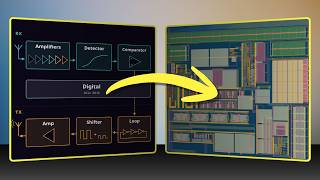
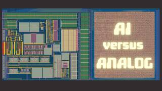

  

# An open-source 433 MHz radio on a chip

Two boards with the same chip talk to each other over the air. Each one has two bare wires for an antenna and no other
external parts. The transmitter keys an on-chip oscillator on and off (on-off keying, OOK) with a code set on 7 DIP
switches. The receiver amplifies what the antenna picks up by about 80 dB, turns it into a stream of bits and looks for
the same code. When it hears it, it toggles an LED. The estimated range is about 70 m in good conditions; it hasn't
been measured yet.

The chip is a [Tiny Tapeout](https://tinytapeout.com) project: six tiles (3 × 2) of a shared chip on the SkyWater
130 nm process (sky130), shuttle ttsky26d. It was designed with an AI agent (Claude) doing most of the work, see
[How it was made](#how-it-was-made). At the time of writing it is in fabrication, so every result here is simulated.

- **Click through it:** the [interactive explainer](https://mattvenn.github.io/ook-asic-radio/docs/explainer.html)
  steps through the link, the transmitter and the receiver with simulated waveforms at each block.
- **Read about it:** [Can AI design an analog chip? I built a radio to find out](https://www.zerotoasiccourse.com/post/ai_codesigned_radio/)
  on the Zero to ASIC Course site ([zerotoasiccourse.com/radio](https://zerotoasiccourse.com/radio)).
- **Watch it:**

  
  

  [An open-source radio in 0.1 mm² of silicon: how it works](https://www.youtube.com/watch?v=fUDIhpx34Qk) ·
  [I put AI to the test on analog chip design](https://www.youtube.com/watch?v=c53n4mH_RYg)
- **Use it on a Tiny Tapeout board:** the datasheet page, [docs/info.md](docs/info.md).

> **Radio regulations.** This is an experimental, uncertified transmitter. Its free-running ring oscillator is not tuned: it can land anywhere in about 330–560 MHz (~448 MHz typical), mostly outside the narrow 433.05–434.79 MHz licence-exempt band, and its square-wave output has strong harmonics. That range includes frequencies used by aviation, emergency services and the 406 MHz distress beacons. Power is low (about +3 dBm, 2 mW, into the dipole), but transmitting over the air may need an amateur radio licence (the 70 cm band is 420–450 MHz in the US, 430–440 MHz in the UK and much of Europe), and where the chip lands outside the amateur band it may not be legal at all. Measure the frequency with an SDR first, keep transmissions short, and prefer the cabled link test ([docs/bringup.md](docs/bringup.md)). Receiving is fine. You are responsible for following your local rules.

<!-- The section headings below are linked from docs/info.md, which is frozen into the Tiny Tapeout datasheet.
     Don't rename them. -->

## How it was made

An AI agent (Claude, in Claude Code) did most of the design work: the plan, the schematics, the layout generators, the
digital design and the verification. Matt Venn set the direction with bench measurements, caught its mistakes, did the
floorplan and signed off each decision. The [article](https://www.zerotoasiccourse.com/post/ai_codesigned_radio/) and
the [second video](https://www.youtube.com/watch?v=c53n4mH_RYg) tell the story, including what the agent got wrong.

The whole log is in the repo:

- [docs/history.md](docs/history.md): what was done and when, newest first.
- [docs/archive/prompts.md](docs/archive/prompts.md): the session transcripts.
- [PLAN.md](PLAN.md): the design plan and the measurements behind each decision.
- [docs/review_harald_2026-11-13.md](docs/review_harald_2026-11-13.md): Harald Pretl's design review and the actions
  taken.
- [docs/learnings.md](docs/learnings.md), [docs/sim_learnings.md](docs/sim_learnings.md): what was learnt on the way.

## How it works

- **TX:** a 22-inverter ring oscillator (around 448 MHz typical) is keyed on and off with a 127-chip Gold code. Level
  shifters and two antiphase 3.3 V drivers feed the dipole, about +3 dBm.
- **RX:** a 6-stage NMOS differential-pair limiting amplifier feeds a successive-detection log detector, which turns RF
  power into a voltage. A comparator compares it against its own slow average plus a trim, set by a servo in the
  digital logic. The digital logic correlates the bits against the receiver's code.

[docs/how_it_works.md](docs/how_it_works.md) has the theory, the specs, every schematic and the layout.
[docs/slicer.md](docs/slicer.md) explains the comparator and trim servo.

## Pins

The pin list is in [info.yaml](info.yaml); [PLAN.md "Pin map"](PLAN.md#pin-map) explains the straps and debug modes,
and the [`radio_digital` RTL header](verilog/rtl/radio_digital.v) has the exact behaviour. `tools/check_pinout.py`
checks that info.yaml, the top schematic and the digital macro agree.

## Schematics

Drawn in xschem under [xschem/](xschem/) (written by the generators in `xschem/gen/`). The top level is
[tt_um_mattvenn_radio](https://xschem-viewer.com/?file=https://github.com/mattvenn/ook-asic-radio/blob/main/xschem/tt_um_mattvenn_radio.sch);
the analog part is [radio_analog](https://xschem-viewer.com/?file=https://github.com/mattvenn/ook-asic-radio/blob/main/xschem/radio_analog.sch).
[docs/how_it_works.md](docs/how_it_works.md) walks through each block.

## Layout

- The whole tile: [3D view](https://gds-viewer.tinytapeout.com/?url=https://raw.githubusercontent.com/mattvenn/ook-asic-radio/main/gds/tt_um_mattvenn_radio.gds)
  ([gds/](gds/), [lef/](lef/)).
- Every block, with sizes and viewer links: [layout/README.md](layout/README.md). The blocks are drawn by Python
  generators in [layout/gen/](layout/gen/).
- How the layout was done, the rules and per-block notes: [docs/layout.md](docs/layout.md).

## Digital

The `radio_digital` macro: [verilog/rtl/](verilog/rtl/), cocotb tests in [verilog/test/](verilog/test/) with vectors
from the Python model in [model/](model/), formal and equivalence checks in [formal/](formal/), hardened with LibreLane
([openlane/radio_digital/](openlane/radio_digital/), result in [macros/radio_digital/](macros/radio_digital/)).

## Verification

- [docs/verification.md](docs/verification.md): how every check is run, with links to the results.
- [docs/verify_tall.md](docs/verify_tall.md): the latest full re-verification of the extracted design.
- Simulated receiver sensitivity (full gain, typical chip, including the transistors' own noise): reliable detection at
  −90 dBm, half the sends detected at about −92.3 dBm. The earlier figure of −92 dBm reliable came from a model with an
  assumed noise figure, which turned out ~1.5–2 dB optimistic
  ([verify_tall.md, "Device noise in the mixed bench"](docs/verify_tall.md#device-noise-in-the-mixed-bench-action-13-follow-up-2026-11-22)).

## Bring-up

[docs/bringup.md](docs/bringup.md): the plan for testing the chips when they arrive, stage by stage, with the expected
values.

## Status

[STATUS.md](STATUS.md): where the design stands and what's open. [TODO.md](TODO.md): the open items outside the chip
design.

## Repo layout

| Path | Contents |
|---|---|
| `info.yaml`, `docs/info.md`, `src/project.v` | TT project files; `src/project.v` is the LVS stub |
| `gds/`, `lef/` | The tile as submitted (exported by `layout/export_tt.sh`) |
| `xschem/` | Analog schematics and testbenches, generated by `xschem/gen/` |
| `layout/` | Block layout generators (`layout/gen/`, KLayout Python), block GDS, DRC / LVS / PEX scripts, extracted netlists (`layout/pex/`), the floorplan and the TT template DEF (`layout/floorplan/`) |
| `sim/` | Simulations per block and system level; `sim/rerun/` is the job scheduler for full re-verifications |
| `verilog/rtl`, `verilog/test` | Digital macro `radio_digital` and its cocotb tests (vectors from the model) |
| `openlane/radio_digital`, `macros/radio_digital` | LibreLane config for the digital macro, and the hardened macro with its signoff |
| `formal/` | Formal checks and the eqy equivalence check of the macro |
| `test/` | cocotb smoke tests at the TT pin level |
| `model/` | Bit-exact Python model and the RX performance studies |
| `bench/` | Phase-0 bench tools and measurements (recorded RF stimuli in `stim/` are kept locally, not in git) |
| `tools/` | `tools/osic` runs IIC-OSIC-TOOLS commands headless from this repo; floorplan, power and pinout helpers |
| `docs/` | Design and verification docs; the explainer source is in `docs/explainer/`; finished handoffs, plans, old verification reports and the session transcripts (`prompts.md`) are in `docs/archive/` |

## Resources

- [Tiny Tapeout](https://tinytapeout.com) and its [analog specs](https://tinytapeout.com/specs/analog/)
- [Zero to ASIC Course](https://zerotoasiccourse.com)
