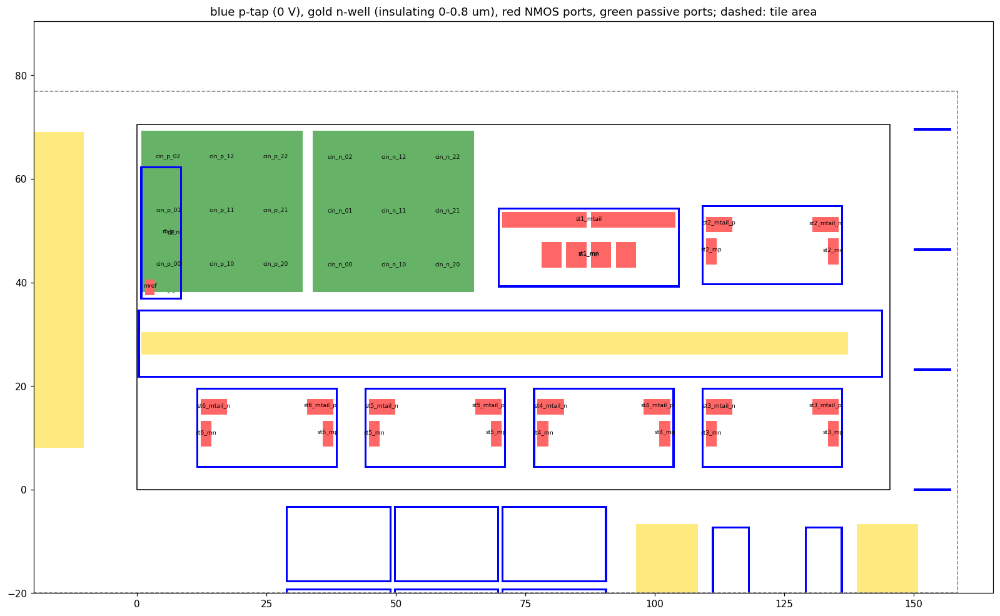

# Output → input coupling through wires and substrate (2026-10-29)

The chain has 73–81 dB of gain. At ss 10 °C, 0.5 fF of asymmetric out_p → pad_p coupling makes it oscillate (`docs/stability_2026-10-17.md`), and the layout budget is 0.1 fF. Until now the only evidence that the layout meets that budget was magic's extraction ("0 aF" from out / o5 / o4 into the input), and nothing covered the substrate. This note measures both, on main's lna_chain (`7b9def1`, before the lna_lo shunt).

**Result:** both are far below budget.
- **Wires (kpex 2.5D):** ≤ 0.3 aF asymmetric from the output wires, ~13–20 aF from the st5 / st6 source plates (an upper bound).
- **Substrate:** an out_p → pad_p equivalent of **~1e-5 fF**, ~10,000× under the 0.1 fF budget, and still ~100× under it with the substrate conductances divided by 100.

Substrate feedback isn't a stability risk for this layout. What it can't rule out is coupling off the die (bond wires, package, PCB, the antenna), which is what the lna_lo strap is for (`docs/handoff_lna_lo.md`).

## 1. Wire coupling: kpex 2.5D

The sky130 magic tech file has `sidehalo 8` (µm): magic computes no lateral / fringe coupling between shapes more than 8 µm apart. The late stages are across a 14 µm moat from the input, so magic's 0 aF was the cutoff, not a measurement. KLayout-PEX (kpex 0.3.12, in the tools image) has a 2.5D engine with a configurable halo.

**Setup** (scripts in `sim/kpex/`):
- kpex can't use the hierarchical GDS: the five amp_dpc instances' internal nets merge under one name, and its LVS fails. So `flatten.py` writes a flat GDS with stage-prefixed labels (`st1_tail`, `st2..6_sp/sn`).
- `flatref.py` writes a flat reference netlist: m / nf folded into W, the bulk on `sky130_gnd`, resistor L rounded up to the drawn 0.01 µm, MIMs given by A / P.
- `lvs.sh` runs kpex's deck with `combine=true schematic_simplify=true top_lvl_pins=true`: "Netlists match".
- kpex then runs on that LVSDB: 22 s at halo 8, 89 s at 50, 116 s at 100, 130 s at 200.

**Asymmetric coupling**, aF: [C(Xp→Vp) − C(Xp→Vn)] / [C(Xn→Vn) − C(Xn→Vp)], and dm = half the sum (the differential feedback capacitance). Halos 50, 100 and 200 agree except where noted.

| aggressor | → inp / inn | → g1p / g1n | → o1p / o1n |
|---|---|---|---|
| out, o5 | 0 | 0 | 0 |
| o4 | 0 | −0.27 / +0.21 (dm −0.03) | 0 |
| o3 | 0 | 0 / −0.05 (dm −0.03) | 0 |
| st6 source plates (Cs, met4) | +0.1 (dm 0.05) | **+29.3 / −2.9 (dm +13.2)** | 0 |
| st5 source plates | −0.27 (dm −0.13) | **−42.1 / +3.0 (dm −19.5)** | 0 |
| st4 / st3 sources | 0 | 0 | ≤ 0.5 (dm ≤ 0.26) |

- **Halo 8 reproduces magic's 0.**
- **The output wires** couple ≤ 0.3 aF asymmetric at every halo, more than 300× under budget.
- **The only real path across the moat** is met4 sidewall from the st5 / st6 Cs plates to the g1 met4, about 50 µm apart.
  - Those nodes carry roughly the stage's input (o4 / o5 level, 10–25 dB below out), so the output-equivalent is a few aF.
  - kpex's sidewall model is a 1/d law that only same-layer shapes block. At 50 µm, with the MIM plates and the substrate in between, it overstates the coupling: treat these numbers as an upper bound. A FasterCap run of that corner would give the real value.
- **Inside one stage:** o2 → o1 is ~0.3 fF dm. That's stage 2's own gate-drain coupling, one stage of gain, so harmless.
- **Substrate capacitance (VSUBS):** the victims' capacitance to the substrate isn't balanced:
  - g1p 17.4 fF vs g1n 13.0 fF;
  - inp 7.75 fF vs inn 7.06 fF.

  That imbalance is the common-mode → differential conversion the substrate study below includes.

## 2. Substrate: 3D conduction solve → R network → stability bench

### Inputs
- **At 434 MHz the substrate is resistive.** The dielectric relaxation frequency at 20 Ω·cm is ~15 GHz, so a DC conduction (Laplace) solve gives the network. Junction and well capacitances come from the device models; wire-to-substrate capacitances come from kpex.
- **Bulk resistivity, ~20 Ω·cm (range 15–35).** The PDK docs don't publish it (device-details and RCX pages). It was derived from the PDK's own junction models: n-well → p-sub (`diode_ps2nw`) has CJ = 9.16e-5 F/m² and PB = 0.535 V. Treated as a one-sided abrupt junction that gives Na ≈ 5e14 cm⁻³, ~25 Ω·cm; deep n-well → p-sub (`diode_ps2dn`) gives ~35 Ω·cm.
- **Surface p-well:** 3050 Ω/□ (RCX table 91) over 0.7 µm (`sky130.xs` cross-section), ρ ≈ 0.21 Ω·cm, everywhere that isn't n-well. There's no deep n-well in this design.
- **N-well** (0 – 0.8 µm) is junction-isolated, so it's insulating for this solve.
- **P-taps** (tap ∩ psdm, outside n-well) are VSS (`gchip` in `sim/chain/stability.sh`), at 0 V.
- **Die thickness and backside** are unknown (the TT package's die attach isn't documented). They were run floating at 300 µm, and grounded at 300 µm and 150 µm.

### Method (scripts in `sim/substrate/`)
1. **Geometry** (`geom.py` → `geom.json`, picture below):
   - The block is the flat GDS from §1, plus a 20 µm margin from `gds/tt_um_mattvenn_radio.gds` (the tile's own lna_chain instance removed), so the neighbours' taps count.
   - 3168 µm² of the margin lies outside the tile. It was left as p-well with no taps, which is pessimistic.
2. **Ports: 44 surface patches.**
   - Each NMOS active island is one port, named from the LVSDB device: st1 Mp / Mn / tail, st2..6 Mp / Mn / tail_p / tail_n, Mref. All 27 islands are assigned.
   - The Rb_p / Rb_n poly footprints.
   - Cin_p and Cin_n split 3 × 3 each, so the 31 µm plates don't short the p-well under them.
3. **Solve** (`solve.py`):
   - Cell-centred finite differences with harmonic-mean conductances, pyamg-preconditioned CG to 1e-9, one solve per port with the taps at 0. This gives the 44-port admittance matrix Y, symmetric to 1e-6.
   - Vertical grid: the p-well in ~h/4 cells, one cell 0.7–0.8 µm, then ×1.35 geometric growth to the backside.
   - h = 1 µm: 0.46 M unknowns, ~5.5 min. h = 0.5 µm: 2.24 M unknowns, 66 min, 2.2 GB.
4. **Netlist** (`vsubs_map.py`, `mknet.py`): the kpex h100 netlist, CC only.
   - **Case a:** every bulk and every substrate capacitance on VSS (the assumption until now).
   - **Case b:** each NMOS bulk on its own port. Rb bulks on rb_p / rb_n, each load resistor's bulk on the port of the device it loads. Each net's substrate capacitance is split over the nearest ports / taps using kpex's per-shape report (e.g. inn all to the cin_n patches, inp 74 % cin_p / 26 % VSS, g1p 44 % st1_mp / 45 % the Cin patches). Y becomes 946 resistors to VSS, none dropped.
   - **Cut variants** remove links for comparison: `--cut` removes st3–st6 ↔ {st1, Cin, Rb, Mref}; `--cutall` removes every link between different stages.
5. **Bench** (`mkbench.py`, `stab.sh`): the unmodified `sim/chain/stability.sh` (2 nH, real decap, 1 µA kick, AC) at tt 27 °C and ss 10 °C.
6. **Equivalent Ccpl** (`acx.sh`, `cmp.py`):
   - Peak-dB matching can't resolve something this small, so this compares complex AC transfers (200 points per decade).
   - The substrate feedback term (H_b / H_b,cut − 1) is divided by the term a 0.01 fF out_p → pad_p capacitor adds to case a.



### Resistances

Each port's R to the taps is given with the other ports shorted / floating. The transfer Z is open-circuit, between ports with the taps at 0.

| solve | st6_mn | st1_mp | st1_mtail | cin_p_11 | Z st6_mn → st1_mp | Z st6_mn → cin_p_11 | Z st5_mp → cin_n_10 |
|---|---|---|---|---|---|---|---|
| h 1, ρ 20, backside floating 300 µm | 363 / 379 Ω | 193 / 283 Ω | 66 / 72 Ω | 83 / 157 Ω | 7.1 mΩ | 67 mΩ | 214 mΩ |
| h 0.5 (grid halved) | 290 / 300 Ω | 198 / 282 Ω | 77 / 85 Ω | 58 / 110 Ω | 8.7 mΩ | 55 mΩ | 86 mΩ |
| backside grounded, 300 µm | same | | | | 5.6 mΩ | 61 mΩ | 196 mΩ |
| backside grounded, 150 µm | same | | | | 4.2 mΩ | 56 mΩ | 177 mΩ |
| ρ 15 | ±1 % | | | | 9.7 mΩ | 89 mΩ | 277 mΩ |
| ρ 35 | ±1 % | | | | 3.8 mΩ | 39 mΩ | 128 mΩ |
| moat p-taps removed | same | | | | 9.4 mΩ | 178 mΩ | 709 mΩ |

- **Local:** each device sees 290–400 Ω to its own stage's tap ring.
- **Far:** a few mΩ to ~0.2 Ω. The current goes through the bulk, so it scales ~1/ρ: ρ 15 is the worst case.
- **Backside:** floating is the worst case; grounding it lowers the transfer by 20–40 %.
- **The moat's p-tap ring:** without it, st6 → st1 rises only ×1.3, but st6 → Cin rises ×2.6–3.3, st5 → Cin ×3.3 and st6 → Rb ×6.4. The stages' own rings do most of the isolation, and the moat mostly protects the input passives.
- **Grid convergence:** halving the grid moves device self-R by ~20 % and far transfers by +23 % to −60 %. Rb_p moves 1098 → 64 Ω because the 0.35 µm strip rasterises badly at 1 µm; it carries little capacitance. The equivalent Ccpl agrees to within 25 % between the two grids.

### Stability bench (L 2 nH)

Gain at 434 MHz / peak, dB; growth = late / early kick envelope (< 1 decays).

| case | tt | ss 10 °C | growth |
|---|---|---|---|
| magic RC pex (reference) | 76.21 / 77.46 | 80.46 / 81.62 | ~2e-9 |
| (a) kpex, bulks + substrate caps on VSS | 78.04 / 78.63 | 82.47 / 82.97 | 4–6e-10 |
| **(b) substrate network** | **78.03 / 78.64** | **82.46 / 83.00** | 4–5e-10 |
| (c) network conductances ÷ 10 | 77.48 / 78.49 | 81.60 / 82.74 | ~5e-10 |
| (c) network conductances ÷ 100 | 72.53 / 74.27 (peak at 302 MHz) | 75.12 / 76.91 | ~5e-10 |

- **(b) vs (a):** < 0.03 dB, and the kick decays to the numerical floor. Each cut variant matches its full network to 0.001 dB.
- **A much weaker substrate costs gain, not stability.** At ÷ 100 the devices' bodies are poorly tied and the body effect lowers each stage's gain.
- The kpex CC netlist has no wire R, so it runs ~1.8–2 dB above the magic RC pex. The feedback test is therefore slightly pessimistic.

### Calibration and equivalent coupling

Ccpl out_p → pad_p on case a, peak dB:

| Ccpl | tt | ss 10 °C |
|---|---|---|
| 0.1 fF | 78.75 | 83.63 |
| 0.3 fF | 81.35 | 91.25 |
| 0.5 fF | 87.19 | **oscillates** (1.9 V pp late) |
| 1 fF | **oscillates** | oscillates |

So the threshold is 0.3–0.5 fF at ss 10 °C and 0.5–1 fF at tt, consistent with 2026-10-17.

Equivalent out_p → pad_p coupling of the substrate network, fF, at 434 MHz (worst in 200 MHz – 1 GHz in brackets). Both corners are similar, and the term is mostly in phase with a capacitor.

| network | late stages ↔ input only | every inter-stage link |
|---|---|---|
| h 1, × 1 | 1.2e-5 (2.8e-5) | 1.4e-4 (4e-4) |
| h 0.5, × 1 | 0.9e-5 (2e-5) | 0.7e-4 (2e-4) |
| ρ 15 | 1.6e-5 (3.7e-5) | 1.5e-4 (4.4e-4) |
| moat taps removed | 2.1e-5 (4.5e-5) | 1.5e-4 (4.3e-4) |
| conductances × 0.1 | 6e-5 (2.3e-4) | |
| conductances × 0.01 | 9e-5 (2.8e-4) | 7.8e-4 (5e-3) |

**Margin:** about four orders of magnitude for the realistic substrate, and more than 100× even at conductances × 0.01 (≥ 20× counting every link).

## Least certain
1. **DC conduction only.** The substrate's own capacitance isn't modelled (valid well below ~15 GHz). Junction and well capacitances come only from the device models.
2. **Port model:** each device's body is an equipotential patch on its active area. The Cin plate capacitance is spread over 9 patches.
3. **No wire R** in the kpex CC netlist (optimistic gain, slightly pessimistic feedback).
4. **No taps assumed outside the tile.**
5. **Thin features on the 1 µm grid** (the Rb strip, thin tap rings), hence the halved-grid check.
6. **Main's layout, not the final one.** The lna_lo shunt (`docs/handoff_lna_lo.md`) sits at the moat's turn end, ~100 µm from the input section and next to where o2 already crosses. Rerun on the final layout to confirm.
7. **Off-die paths aren't covered:** bond wires, package, PCB, the antenna.

## Rerun

The scripts expect to run from `build/kpex/` and `build/substrate/` and write their outputs there:

```
mkdir -p build && cp -r sim/kpex build/kpex && cp -r sim/substrate build/substrate
# one-time: pyamg needs Python headers -> a uv-managed venv (no root)
tools/osic-mac bash -c 'export UV_CACHE_DIR=$PWD/build/substrate/uvcache UV_PYTHON_INSTALL_DIR=$PWD/build/substrate/uvpython; U=/foss/tools/uv/bin/uv; $U venv --python-preference only-managed --python 3.12 build/substrate/venv; export CPATH=$PWD/build/substrate/uvpython/cpython-3.12.9-linux-aarch64-gnu/include/python3.12; VIRTUAL_ENV=$PWD/build/substrate/venv $U pip install numpy scipy pyamg'
# kpex (§1)
tools/osic-mac python3 build/kpex/flatten.py
python3 build/kpex/flatref.py
tools/osic-mac build/kpex/lvs.sh
for H in 8 50 100 200; do tools/osic-mac kpex --pdk sky130A --lvsdb build/kpex/lvs/lna_chain.lvsdb.gz \
  --cell lna_chain --2.5D --halo $H --mode CC --blackbox True --out_dir build/kpex/h$H --threads 6; done
python3 build/kpex/couple.py h8 h50 h100 h200 > build/kpex/tables.txt
# substrate (§2); needs build/real/tb_chain.spice (xschem -n -s -q -o build/real xschem/tb_chain.sch)
tools/osic-mac python3 build/substrate/geom.py                 # ~1 min
tools/osic-mac python3 build/substrate/vsubs_map.py h100       # ~20 s
tools/osic-mac build/substrate/runall.sh                       # 7 solves, 2 streams x 3 threads: 66 min
tools/osic-mac bash -c 'cd build/substrate && venv/bin/python report.py h1_n300 h05_n300 h1_d300 h1_d150 h1_n300_r15 h1_n300_r35 h1_n300_nomoat'
tools/osic-mac bash -c 'cd build/substrate && venv/bin/python mknet.py --case a --out sim/a/lna_chain_sub.spice && python3 mkbench.py sim/a sim/a/lna_chain_sub.spice'
#   case b: --case b --Y h1_n300 --gscale 1|0.1|0.01 [--cut|--cutall] into sim/b1, b10, b100, b*cut
tools/osic-mac build/substrate/stab.sh a                       # tt + ss: 45 s + 80 s
tools/osic-mac build/substrate/stab.sh a "2n:0.01f 2n:0.03f 2n:0.1f 2n:0.3f 2n:0.5f 2n:1f"
tools/osic-mac build/substrate/acvar.sh h05_n300 1 h05x1       # full / cut / cutall AC + equivalent Ccpl, ~6 min
```

- The uv Python path above is for the aarch64 image on the Mac; on another machine, use its platform's path.
- The solver runs 3 threads per stream. Running more streams than CPUs oversubscribes.
