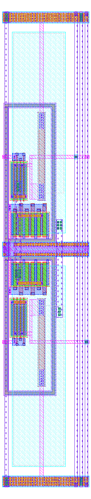
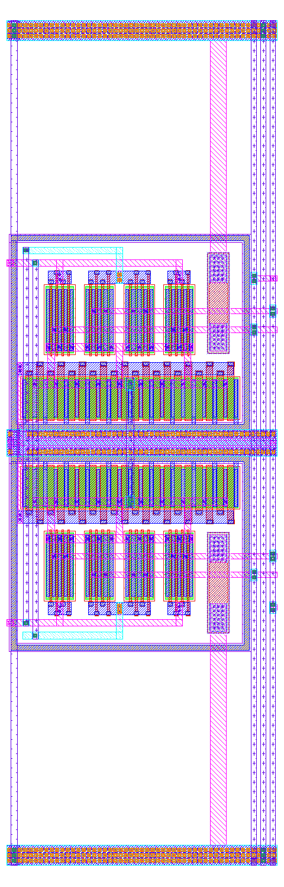
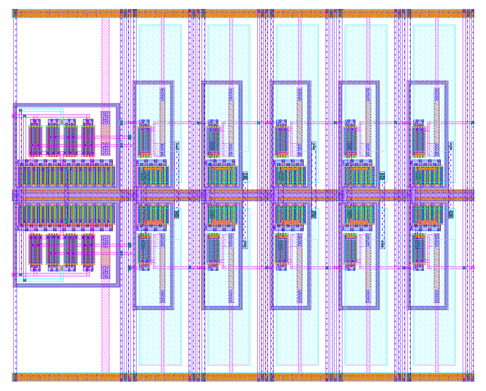
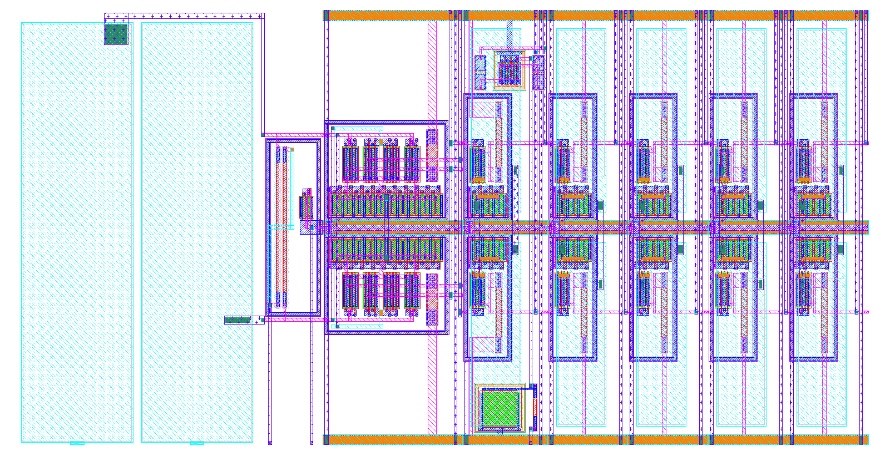

# Tall, thin chain stages and a straight chain (2026-11-13)

Harald Pretl's review ([review_harald_2026-11-13.md](review_harald_2026-11-13.md), point 5, action 8) suggested a straight
chain of tall, thin stages in place of the U fold. This job laid out the two stage cells in tall form and abutted them
into a stage strip, to find out whether a straight chain fits the U's slot (145.4 × 70.5 µm). Brief:
[handoff_tall_stages.md](handoff_tall_stages.md). Branch `chain-tall-stages`. Nothing in the chain, the tile or the
floorplan changed: these are new cells beside the old ones.

**Result: the whole chain is drawn straight, and it fits, with room to spare.** `lna_chain_t` is the input section,
stage 1, stage 2 with the low-gain shunt built in, and stages 3 to 6, all abutted. It is **124.0 × 63.5 µm against the
U's 145.4 × 70.5 µm slot**. It is clean (DRC 0 in magic and KLayout, antenna 0) and matches LVS against today's chain
devices and ports.

Extracted, in the same stability bench as today's chain (`tb_chain`, 2 nH, real decap, 1 µA kick):
- **Gain:** 0.37 dB more than today's U at both tt and ss 10 °C (75.84 vs 75.47 dB, and 79.88 vs 79.51 dB, at 434 MHz).
- **Stability margin:** the same as today's. Each chain survives up to 0.75 fF of added output-to-pad coupling at tt and
  0.5 fF at ss 10 °C, against a 0.1 fF budget.
- **Own coupling:** the layout's wiring couples 0 aF from stages 3–6 and the outputs back to the input side, as in the U,
  but the output is now about 120 µm from the input instead of 14 µm across a moat.

The open point is the floorplan. log_det's inputs don't line up with the straight chain's taps, so it needs to move
west, and ideally its pins need to move too ("Taps" below).

The first part of this report is the two-cell sketch and the stage strip. The second part ("Stage 2 with the shunt"
onwards) is the shunt, the taps, the input section and the full chain.

All extractions use magic 8.3.642 (`OSIC_MAGIC=$HOME/.local/magic642/bin`), as for the committed ones.

## The cells

Files: `layout/gen/amp_dpc_tall.py` (cell `amp_dpc_t`), `layout/gen/amp_dp_tall.py` (`amp_dp_t`), GDS in `layout/`,
LVS references in `layout/ref/`, extractions in `layout/pex/`. Same circuits and `PARAMS` as `amp_dpc` / `amp_dp`; the
reference is today's (written by `lay.write_ref`), with only the Cs MIM's W and L changed to the drawn rectangle.

Both cells share one frame, so any stage abuts any other:

- **Halves stacked.** The p half sits above the cell's horizontal centre line and the n half is its mirror image below
  (the generator draws one half cell and places it twice).
- **VSS and nb on the centre line, VDD at the top and bottom edges.** VSS goes in the centre because that is where
  the circuit starts. Going out from the centre, each half has the tail (its sources go straight down into the ring
  and rail on met1), the nb strap, the pair, the load and then VDD, so nothing crosses. nb runs on met2 sandwiched
  inside the VSS rail (met1 + met3, with met2 strips at its edges), and each tail's gate strap drops to it on one
  met2 riser. With nb on the centre line too, a flipped (MX) cell lines up with an unflipped one. The two VDD rails
  are joined inside each cell by a met4 column at its left edge.
- **Signals on met2 at the pair's gate height**, ±12.37 µm from the centre. The input enters from the left edge
  straight onto the gate strap. The output (drain bar and the load's bottom head, joined by a met2 spine) leaves at
  the same height to the right edge. So a stage's outputs land on the next stage's inputs.
- **Polarity:** the top half's drain is `outn`. Flipping every other stage puts `outn` onto the next stage's `inn`,
  with no crossover and no schematic change. LVS of the strip checks this, and un-flipping stage 2 fails it.
- **Taps:** each output also runs up a met4 column the full height of the cell, at the right edge, so both outputs
  reach either long edge. A VDD column sits between the two tap columns as a shield (see below).

Pin heights, from the cell's bottom edge (H = 63.5 µm, centre line 31.75 µm):

| | layer | y (µm) |
|---|---|---|
| VDD rails | met1–met3 | 0–1.5 and 62.0–63.5 |
| VSS rail | met1–met3 (met2 at its edges) | 30.75–32.75 |
| nb | met2 | 31.55–31.95 |
| stage signals (in, left edge / out, right edge) | met2 | 19.18–19.59 (n half) and 43.91–44.31 (p half) |
| amp_dp_t inputs (left edge, to the input section) | met2 | inn 17.97–18.47, inp 45.03–45.53 |
| taps | met4 columns, full height | outn at W − 1.95 … W − 1.55, outp at W − 0.55 … W − 0.15 |

### amp_dpc_t (stages 2 to 6)

Fig. 1. amp_dpc_t, 11.7 × 63.5 µm. The tails sit at the centre with the pair and load above (and mirrored below), the
Cs plates over each half, and the tap columns and VDD shield at the right edge.

- Each half's Cs bottom plate (its source node) covers the half. capm starts above a band where the tail-drain and
  pair-source bars via2 up into the plate, since no via2 may sit under capm. The caps are 6.8 × 21.33 µm rectangles
  with the same C as today's 12.07 µm squares: the model's C is Ca (w + 0.15)(l + 0.15), so the drawn area is kept on
  that basis. The top plates cross over on met4 strips: Cs_a's (left) goes down into plate B's band and Cs_b's (right)
  goes up into plate A's.
- The load is a single 0p69 segment beside the pair. A lone segment fails rpm.1 / psdm.1, so the generator draws
  rpm and psdm 1.3 µm wide over it.
- Cut counts are all at or above the 2× EM rule; the generator prints the check.

### amp_dp_t (stage 1)

Fig. 2. amp_dp_t, 20.4 × 63.5 µm, in amp_dpc_t's frame. The two pair rows (A B B A over B A A B) sit above and below
the split tail, with the loads to their right.

- **Matching kept.** Each pair row is four groups of 4 fingers (5 µm), with the outer two being the half's own device
  and the inner two the other half's. So the top row is A B B A and the bottom row B A A B (A = Mp, B = Mn). Each
  device has half its fingers in each row, and its centroid is the cell centre in x and y. There is one orientation
  per row, and all sources are on the tail.
- The price is four crossings of the centre, all on met4 (there is no MIM in this cell). Each row's inner-group
  drains go to the other half's output, and its inner gate strap goes to the other half's input. The output
  crossings are the full-height tap columns themselves. The input crossings are two short columns left of the rows,
  away from the outputs. The two halves' tail nodes join on a short met4 column (it carries no DC, by symmetry).
- The tail is 2 × nf 20 (3 µm fingers, as the reference diode), one row per half. 1.2 mA tail; via1 / via2 / via3
  counts meet the 2× rule (generator printout).

### Results per cell

Testbenches: `sim/amp_dpc/tb_amp_dpc.py` and `sim/amp_dp/tb_amp_dp.py`, which now take `--pex-file=<path>` (another
extraction; the subckt name is read from the file) and `--temp=<C>`. Today's `layout/pex/amp_dpc.spice` /
`amp_dp.spice` were not touched. The output C is the extracted total on the net (all R-split sub-nodes).

Table I. amp_dpc: tall vs today (extracted; 434 MHz, differential).

| | today `amp_dpc` | `amp_dpc_t` (taps) | `amp_dpc_t`, no tap columns |
|---|---|---|---|
| W × H | 30.54 × 21.21 µm | **11.7 × 63.5 µm** | 11.7 × 63.5 µm |
| gain tt / ss 10 °C | 13.69 / 14.36 dB | 13.25 / 13.89 dB | **14.05 / 14.75 dB** |
| peak tt | 13.75 dB at 374 MHz | 13.36 dB at 357 MHz | 14.07 dB at 392 MHz |
| −3 dB tt | 153–1010 MHz | 147–963 MHz | 159–1081 MHz |
| −3 dB ss 10 °C | 166–953 MHz | 159–913 MHz | 174–1014 MHz |
| output C (outp / outn) | 18.9 / 24.8 fF | 31.3 / 33.4 fF | 13.7 / 13.7 fF |
| imbalance at 434 MHz | −32.3 dB | −50.4 dB | −72.8 dB |
| DRC / antenna / LVS | clean | magic 0, KLayout 0, antenna 0, LVS match | clean |

Table II. amp_dp: tall vs today (extracted; 434 MHz).

| | today `amp_dp` | `amp_dp_t` (taps) |
|---|---|---|
| W × H | 36.4 × 20.73 µm | **20.4 × 63.5 µm** |
| gain tt / ss 10 °C | 15.58 / 16.45 dB | **15.55 / 16.42 dB** |
| peak tt | 15.76 dB at 205 MHz | 15.78 dB at 196 MHz |
| −3 dB edge tt / ss 10 °C | 1499 / 1364 MHz | 1380 / 1261 MHz |
| output C (outp / outn) | 40.4 / 42.6 fF | 55.8 / 57.1 fF |
| imbalance at 434 MHz | −49.6 dB | −54.8 dB |
| DRC / antenna / LVS | clean | magic 0, KLayout 0, antenna 0, LVS match |

Like for like (no taps, since today's cells have none), amp_dpc_t gains 0.36 dB on today's cell. Its outputs carry
13.7 fF against 18.9 / 24.8 fF, because nothing crosses the cell any more, and the halves are balanced. Both tall
cells are much better balanced than today's, as the mirror geometry intended.

**The tap columns** add about 18 fF per output on amp_dpc_t (10.7 fF to VSS, 7.3 fF to VDD) and cost 0.8 dB per
stage. A first version without the VDD shield coupled the two columns 6.9 fF output to output (which counts twice
for the differential signal) and gave 12.95 dB. On amp_dp_t, with its 1 kΩ loads, the columns cost nothing visible.

## The stage strip

`layout/gen/chain_strip_tall.py` abuts amp_dp_t and 5 × amp_dpc_t, flipping stages 2, 4 and 6 (MX). It has no input
section and no wiring between the stages. Its ports are stage 1's inputs, stage 6's outputs, the taps o1–o5 (the
met4 columns' top ends), nb, VDD and VSS.

Fig. 3. chain_strip_t, 78.9 × 63.5 µm: stage 1 on the left, then stages 2 to 6. The stages abut with no wiring
between them.

- **Checks:** magic and KLayout DRC 0, antenna 0, LVS match against st1 to st6 in series (`layout/ref/chain_strip_t.spice`,
  with the taps as ports). Mutation test: with stage 2 left unflipped, LVS fails ("Top level cell failed pin matching").
- **Length:** exactly 78.9 µm (20.4 + 5 × 11.7).
- **Gain:** `sim/chain/tb_strip_tall.py <strip|u|blocks> [corner] [--temp=C]`. All three cases are driven
  differentially at stage 1's gates (1.2 V DC), with the chain's bias and the outputs and taps unloaded. "u" is
  today's extracted U chain (`layout/pex/lna_chain.spice`, driven at its g1p / g1n nodes, so its input section is out
  of the way). "blocks" is today's block extractions in series, with no wiring between them.

Table III. Stage gain, stage 1 gates to stage 6 output (434 MHz; peak; −3 dB edges; gain per stage st1 … st6).

| | tt 27 °C | ss 10 °C | per stage, tt (dB) |
|---|---|---|---|
| tall strip, tap columns | **79.29 dB**, peak 79.81 at 348 MHz, 231–577 MHz | 83.31 dB, peak 83.83 | 15.34 12.33 12.48 12.42 12.49 14.22 |
| tall strip, no tap columns | 83.58 dB, peak 83.72 at 391 MHz, 251–644 MHz | 87.89 dB, peak 88.01 | 15.41 13.22 13.37 13.24 13.58 14.77 |
| today's U chain (extracted) | **80.87 dB**, peak 81.23 at 369 MHz, 240–594 MHz | 85.05 dB, peak 85.37 | 15.52 11.70 13.00 12.92 13.10 14.62 |
| today's blocks in series | 81.61 dB, peak 81.90 at 369 MHz, 243–605 MHz | 85.82 dB, peak 86.08 | 15.43 12.79 12.94 12.86 13.04 14.53 |

The output imbalance at 434 MHz is −44.8 dB for the strip with taps, −73.5 dB without, and −31.4 dB for today's chain.
These figures are higher than the 76.65 / 80.78 dB quoted for the chain in docs/layout.md, because that bench includes
the input section and the outputs' loads. Compare the rows here with each other, not with those numbers.

The strip without tap columns has 2.7 dB more gain than today's chain (2.0 dB more than the blocks), and nearly all
of that is the shorter output nets. Today's stage 2 gives 11.70 dB in the U against 12.79 dB as a block, a 1.1 dB loss
in this unloaded bench. That is the turn's o2 wiring plus the low-gain shunt across o2, which loads it even when off.
The strip has neither, so this row overstates what a full straight chain would give at stage 2. With full-height tap columns, the strip is 1.6 dB below today's chain at tt (1.7 dB at
ss 10 °C).

**Tap x positions** (column centres, from the strip's left edge): o1n 18.65, o1p 20.05, o2n 30.35, o2p 31.75,
o3n 42.05, o3p 43.45, o4n 53.75, o4p 55.15, o5n 65.45, o5p 66.85, outn 77.15, outp 78.55 µm. Along the chain, with
the input section's 38.6 µm in front, add 38.6: o1 about 57.3–58.7, o2 69.0–70.4, o3 80.7–82.1, o4 92.4–93.8,
o5 104.1–105.5, out 115.8–117.2 µm.

## Stage 2 with the low-gain shunt (amp_dpc_ts)

`layout/gen/amp_dpc_shunt_tall.py`, cell `amp_dpc_ts`, is 12.4 × 63.5 µm (amp_dpc_t plus 0.7 µm). The shunt
(`lna_shunt`: o2p, Rh_a 421 Ω, Msw PMOS W 18 / L 0.15, Rh_b 421 Ω, o2n, with the gate from `lna_lo_n` through Rg 20 kΩ
and Mcap) uses the free space above each half's ring, under the Cs plates. Today's Rb and Mref sit under Cin the
same way.

- Msw sits between Rh_a and Rh_b in one half, and each Rh lands on its output's tap column. Mcap and Rg sit in the
  other half.
- The gate node gi crosses the centre on one extra met4 column next to the outn column. `lna_lo_n` comes in on the
  same column's lower segment, with its pin at the cell edge.
- The loads' VDD risers jog to the left edge to free the space. The plates, caps and height are unchanged.
- Checks: clean, and LVS matches amp_dpc + lna_shunt. The one antenna "feedback" entry is magic's note on Mcap, a
  MOS cap with source, drain and body on VDD. Today's `lna_chain` has the same entry.

Low gain works as today's: in the strip (stage 1 gates to the output, unloaded, tt), the gain goes from 78.36 dB to
68.28 dB with `lna_lo_n` = 0, a step of 10.1 dB. Today's U gives 80.87 to 70.70 dB, a step of 10.2 dB. Off, the shunt
costs stage 2 about 0.9 dB (12.33 → 11.42 dB in the strip), as its C does today. The strip numbers in Table III are
without the shunt.

## Taps

**Where log_det is.** log_det sits north of the chain slot, at tile x 67.5–154.8 and y 80–111, 10 µm above the
chain's north edge. The RX pads ua[1] / ua[0] are at tile x 117.3 / 136.6 on the south edge, so the input section
has to sit at the east end of the slot. The chain then flows west: it is mirrored (MY) in the tile, and the cells'
top edge is north.

**In the chain:** every stage output reaches the chain's north edge only, on a met4 column from the output's own
height to that edge. The column is 19.4 µm for the output in the north half and 44.1 µm for the one in the south
half, against 63.5 µm for a full-height column. Unflipped stages use cells built with taps to their top edge
(`amp_dp_tu`, `amp_dpc_tu`). Flipped stages use cells with taps to their bottom edge (`amp_dpc_td`, and
`amp_dpc_tsd`, where the shunt is mirrored into the half the tap columns run through). All are made by
`layout/gen/lna_chain_tall.py`. The asymmetry alternates from stage to stage.

**Tap positions** in the tile, with the chain placed so Cin_p's pad tab is over ua[0] (chain from x 21.2 to 145.3):
o1 80.8 / 82.2, o2 68.4 / 69.8, o3 56.7 / 58.1, o4 45.0 / 46.4, o5 33.3 / 34.7, out 21.6 / 23.0 µm (p / n columns).
They leave the chain's north edge at y about 70 µm.

**log_det doesn't fit this as placed.** Its inputs t1–t3 face the chain at x 69–122, and t4–t6 face away from it on
its north edge. The chain's taps are at 22–82. Only o1 → t1 is short (about 1–13 µm). o3 → t3 would be about 60 µm,
and out → t6 about 90 µm plus the way round log_det. **Recommendation:**
- move log_det west, over the stages (it is 87.3 µm wide; the taps span 21.6–82.2 µm);
- re-pin it so all six inputs are on its south edge, in chain order, at or near the chain's tap x. Each tap is then a
  short straight drop across the 10 µm channel.
log_det's pair pitch (about 21 µm) is wider than the stage pitch (11.7 µm), so a re-pin, not just a move, is what
makes every tap short. This is a floorplan and log_det change, not done here.

## The input section (chain_in_t)

`layout/gen/chain_in_tall.py`, cell `chain_in_t`, is **44.4 × 63.5 µm**. Same devices as today's input
(`layout/ref/lna_chain.spice`).

- **Cin_p | Cin_n side by side**, 15.88 × 61.0 µm each, with today's C (the model's (w + 0.15)(l + 0.15) kept). Each pad
  reaches its own cap's bottom plate from the south edge, through a met3 tab (pins `inp` / `inn`).
- **A 6 µm zone** next to stage 1 holds the Rb pair (side by side, rpm merged, across the centre line) and Mref in a
  p-tap ring.
  - Mref's drain and gate (nb, `ibias`) run on met2 into stage 1's nb, and its sources go down into the VSS line.
  - Rb_p's top head goes to g1p and Rb_n's bottom head to g1n. The other two heads (vcm) join on met3.
  - `vcm` and `ibias` also leave on met4 columns at the south edge.
- **Top plates:**
  - g1n leaves Cin_n on a met4 strip straight across at stage 1's inn height.
  - g1p rises above both plates, crosses on met4 clear of Cin_n's capm, and drops down a column to the inp height.
  - Both land 1.2 µm clear of the plate and go into stage 1 on met2.
- Checks: clean, LVS match.

It is 5.8 µm wider than the paper estimate (38.6 µm) because of the zone. Mref and Rb were kept out from under the
pad-side plates, so the pad signal doesn't couple into nb.

## The whole chain (lna_chain_t)

`layout/gen/lna_chain_tall.py` (run `chain_in_tall.py` first). It writes the stage variants and `lna_chain_t`, and its
reference uses today's `lna_chain` port list.

Fig. 4. lna_chain_t, 124.0 × 63.5 µm, drawn with the input on the left; in the tile it is mirrored to flow west. From
the left: Cin_p and Cin_n, the Rb / Mref zone, stage 1, stage 2 (shunt at the top), then stages 3 to 6, each with its
tap columns running to the top edge.

- **Size:** 124.03 × 63.5 µm. Input section 44.4 µm, stage 1 20.4 µm, stage 2 12.4 µm, stages 3–6 4 × 11.7 µm.
  **21.4 µm spare in the slot** (8.1 µm at the west end and 13.2 µm at the east end, with the pad alignment above), and
  7 µm in height.
- **Checks:** magic DRC 0, KLayout DRC 0, antenna 0, LVS match. During assembly, a 0.35 µm psdm gap between the input
  section's ring and stage 1's (rule 0.38) was fixed with 0.1 µm more margin.
- **Extraction:** `layout/pex/lna_chain_t.spice`, 210 devices, 13.4k R, 1.1k C, magic 8.3.642.

### Coupling check

`sim/chain/back_coupling.py <extraction>` lists every coupling C between nets two or more stages apart. It takes each
stage's place in the chain from the extraction itself, because magic's instance numbers don't follow the chain. It
was mutation-tested: a planted 50 aF outp → g1p and a 12 aF o3 → o1 are both reported.

- **lna_chain_t: 0 aF** between any nets two or more stages apart. That includes out, o5, o4 and stages 5–6
  internals into inp, inn, g1, o1 and stage 1 internals. magic's coupling range in this flow is about 200 µm, so the
  distance is within what the extraction sees.
- Today's U (`layout/pex/lna_chain.spice` as committed) also gives 0 aF on this check.
- **Not modelled:** substrate coupling (magic ties the substrate to VSS). In the straight chain, the output is about
  120 µm from the input along the same p-substrate. In the U, it was 14 µm across a guard-ring moat. A 3D substrate
  solve as in `docs/substrate_2026-10-29.md` would confirm it.

### Stability

`sim/chain/stability.sh` on `tb_chain`, with the extracted chain swapped in by `sim/chain/mk_pex_tb.py`. Decks are
in `build/pexsim_t` (tall) and `build/pexsim_u` (today's U), with the same settings: 2 nH supply and ground, the real
VDPWR decap, a 1 µA / 1 ns kick into pad_p, and Ccpl from out_p back to pad_p. "decays" means growth of about 1e-9;
"osc" means growth of about 1.

Table IV. Kick test against added output-to-input coupling, and AC gain (no added coupling).

| | gain at 434 MHz / peak | 0 | 0.3 fF | 0.5 fF | 0.75 fF | 1 fF | 1.5 fF |
|---|---|---|---|---|---|---|---|
| tall, tt | **75.84 / 77.03 dB** | decays | decays | decays | decays | osc 1.01 | osc 1.00 |
| U, tt | 75.47 / 76.83 dB | decays | | decays | decays | osc 1.00 | |
| tall, ss 10 °C | **79.88 / 80.93 dB** | decays | decays | decays (6.8e-8) | osc 0.98 | osc 0.99 | |
| U, ss 10 °C | 79.51 / 80.79 dB | decays | decays | decays | osc 0.99 | osc 0.99 | |

The tall chain has 0.37 dB more gain than the U at both corners, net of its north-only tap columns on one side and
the U's turn and tap stubs on the other. Both chains reach the same coupling edge: stable to 0.75 fF at tt and to 0.5 fF at
ss 10 °C, oscillating at 1 fF and 0.75 fF. At 0.5 fF and ss 10 °C, the tall chain's AC peak rises to 99 dB, against
94 dB for the U, so it is closer to the edge there. The layout itself adds 0 aF. What the straight chain changes is
where coupling could come from: the output is now about 120 µm from the input, not 14 µm across a moat.

## What set the widths, and how to go thinner

- **amp_dpc_t (11.7 µm; target ≤ 16).** The devices need only 7.3 µm (the ring round the nf 6 tail). The width is
  set by the Cs plate (6.8 µm of capm) plus its keep-outs. The plate must sit 1.2 µm from any unrelated met3: on the
  right, that means the tap columns' met3 landings, and those columns plus the shield take 2.6 µm. On the left, the
  previous cell's landings sit across the boundary, which leaves 1.3 µm. To go thinner:
  1. use the slot's full height (capm up to about 25 µm tall), giving about 10.7 µm;
  2. drop the shield and spread the tap columns instead (about −0.7 µm);
  3. land the taps outside the plates' height range, so the 1.2 µm keep-out goes (about −1 µm).
- **amp_dp_t (20.4 µm; target ≤ 22).** The tail sets the width: nf 20 of 3 µm fingers per half is 16.3 µm of
  diffusion. The pair row (11.1 µm) beside its load, plus the input columns, comes to about 17.5 µm, and the output
  columns need 2.1 µm at the right edge. Folding the tail alone barely helps. To go thinner:
  1. put the load above the pair (there are about 17 µm of free height per half);
  2. share diffusion between the pair's groups (all four groups' sources are the tail);
  3. fold the tail into two rows.
  Together these give about 14 µm.
- **Multiple vias** (Harald's point 11): every landing is a cut array as wide as the strip or bar allows. The
  narrowest landings are single-row via1 on the 0.42 µm met2 bars.

## For the floorplan and the tile

- **Placement:** the chain is mirrored (MY) to flow west, with Cin_p's pad tab over ua[0] (x 136.6). It then spans tile
  x 21.2–145.3. Cin_n's plate covers ua[1] (x 117.3); its tab is at the plate centre (x 119.1) and can move along the
  plate's bottom edge.
- **Pins:** at the south edge, `inp` / `inn` (met3 tabs) and `vcm` / `ibias` (met4). At the north edge, the taps
  (met4) and `lna_lo_n` (met4, stage 2's gi column). VDD and VSS run on rails along the whole length.
- **log_det:** move it west and re-pin it, as above. This is the one change the straight chain needs elsewhere in the
  tile.
- **Supply:** the VSS rail (met1–met3, 2 µm) on the centre line and the VDD rails (met1–met3, 1.5 µm) on both long edges
  run the full length. Every stage joins the two VDD rails on met4. The chain draws about 3.0 mA, and end to end the
  rail resistance is about 1–2 Ω, a few mV of drop. Feed both rails at the stage-1 end (the biggest current), away
  from stage 6, with a dedicated trunk as in the power fix.
- **Height:** 63.5 µm, leaving 7 µm of the slot's 70.5 µm free. That is the first lever if length gets tight (the caps
  can be taller and narrower).

## Not done

- No floorplan change: log_det isn't moved or re-pinned, and nothing outside the chain is routed. The tile is not
  rebuilt.
- No substrate coupling solve for the straight chain.
- Stability at tt and ss 10 °C only, with the strap off. There is no small-signal loop-gain margin yet (review action
  4, branch `chain-stability-ac`).
- No Monte Carlo of amp_dp_t's pair, whose matching is common-centroid by construction.

## Floorplan page with the tall chain (2026-11-13)
- **Page:** "Tall Chain Floorplan", https://claude.ai/artifact/Jm514FScc5nMTxUayf8pCD, a separate artifact, so the layout 5 page and its saved variants are unchanged. Built with `tools/floorplan_page.py` from the repo's page sources. Its store is seeded from `layout/floorplan/variants_tall.json`.
- **Blocks:** `tools/floorplan_blocks_tall.py` adds `lna_chain_t` (from its GDS; ibias is the south-edge met4 pin) and the `log_det_t` sketch to `blocks.json`. When `lna_chain_t` is in `blocks.json`, the engine uses it as `xchain` (zones: input section, stage 1, stages 4-6), so older variants that place the U at R180 show the tall chain upside down. Place it MY.
- **log_det_t (sketch, not laid out):** six unchanged det_cells in one row, plus a ~10 µm end section (Mbias, Rs_b, Rdet). It is 135.0 × 16.1 µm with every input reached from the south edge. Cdet (1 pF) doesn't fit in a 16 µm row, so it is the separate estimate block `xcdet`. On the page the sketch is a per-variant option on `xdet` (a checkbox in the selection panel), next to the two-row log_det.
- **Variants:**
  - "layout 5 + tall chain": the chain at (20.3, 6.5) MY, with everything else as in layout 5.
  - "tall chain + unwrapped log_det (sketch)": the row at (15.6, 72.5) MY, with t6 at the west end over stages 5-6 and t1 at the east end, and Cdet at (134.7, 91.1).
- **What the sketch shows:**
  - The row overlaps both TX drivers (y 80.5), which have to move.
  - At the det_cell's 20.8 µm pitch the six detectors spread over the whole chain, while the taps sit in its west half (11.7 µm pitch). t4 lands over stage 2, 3 µm from stage 1's zone, and the page's rule 2 fails on that.
  - A det_cell turned 90° (16.1 µm pitch, about 21 µm tall) would keep t4-t6 over stages 3-6.
