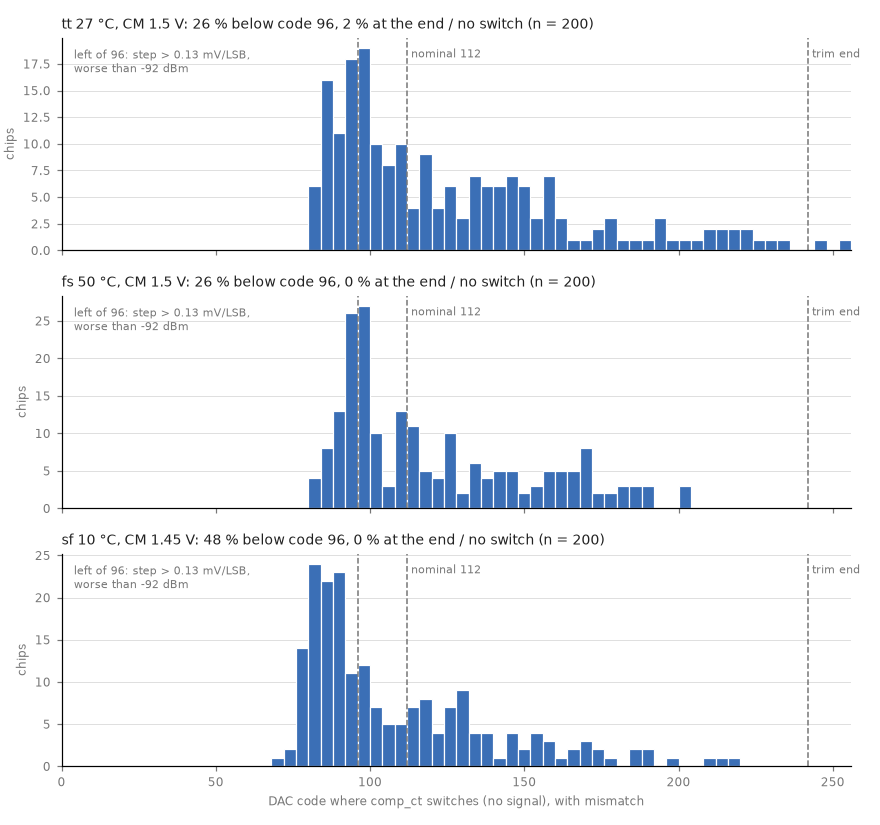
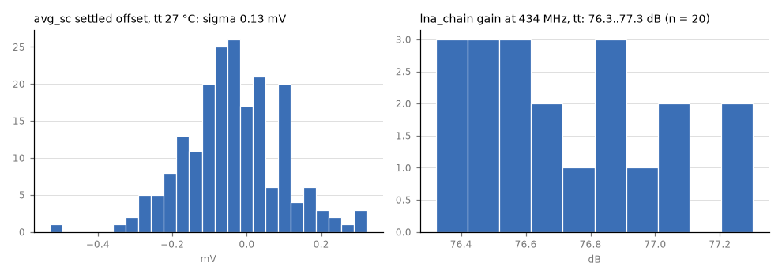

# Supply sweeps and mismatch, 2026-10-12 (sim-0)

Phase 2 of [plan_verify_gaps.md](plan_verify_gaps.md): gaps G1 (supply never varied at system level) and G2
(no mismatch on the comparator path). `main` after d198dbe, ring `NINV` 22, sim-0, IIC-OSIC-TOOLS 2026.09
(ngspice 47). Supplies: VDPWR 1.71 / 1.80 / 1.89 V, VAPWR 3.0 / 3.3 / 3.6 V (the plan's ±5 % / ±10 %; the TT
board tolerances were not looked up, so these may be wider than real).

## Summary

| Check | Result |
|---|---|
| RX chain gain / NF over VDPWR (tt 27, ss 10, fs 50 °C) | ✅ ±0.4 dB, NF unchanged (ideal bias sources) |
| Detector idle / slope over VDPWR | ✅ idle tracks VDPWR (1.44 / 1.52 / 1.60 V at tt); slope 11.8–14.1 mV/dB |
| Comparator offset at the operating CM, trim step | ✅ +0.4…+1.7 mV (nominal devices), step 0.064–0.069 mV/LSB |
| e2e −92 dBm at every supply × corner (nominal devices) | ✅ 12/12 at all 9 points |
| Chain stability, 1.89 V, ss 10 °C, 0.1 fF rule | ✅ stable (growth ≤ 5e-9), +1.6 dB peaking at 576 MHz with 0.1 fF |
| TX, schematic, 5 corners × 3 × 3 supplies | ⚠️ **ss at 1.71 V / 3.6 V: the p arm never turns on** (enable level shifter `tx_ls_en` stuck); fs there is weak (+3.4 dBm). Power follows VAPWR (−1.2 / +1.1 dB at 3.0 / 3.6 V) |
| TX, extracted ring + driver, 5 corners × 9 supplies | ⚠️ frequency 332–545 MHz on silicon (×0.845), inside the 330–560 MHz RX band but **ss at 1.71 V is at the bottom edge** (and likely below it hot). `tx_ls_en` is worse than in the schematic: **ss and fs at 1.71 / 3.6 V fail**, ss / fs at 1.71 / 3.3 V lose 1.5 dB |
| Analog top with real bias over supply (`tb_tile.py sch`, 7 points) | ✅ RX operating point tracks VDPWR; −60 dBm det drop 0.23–0.35 V everywhere. TX: ss 1.71 / 3.6 V fails here too; ss 10 °C 1.71 / 3.0 V turns off slowly (18 ns) |
| **Comparator-path mismatch (Monte Carlo)** | ❌ **offset sigma 2.9–3.7 mV; ~26 % of chips (tt / fs) and ~48 % (sf 10 °C) land where the trim step is > 0.13 mV/LSB and miss −92 dBm; ~2 % at tt run out of trim** |
| avg_sc mismatch | ✅ settled offset sigma 0.13–0.16 mV |
| lna_chain mismatch (20 samples, tt) | ✅ gain 76.3–77.3 dB (nominal 76.7), no stage saturates |

**Gate 2 needs a decision on the comparator**, and a smaller one on `tx_ls_en` (fails at VDPWR 1.71 V with VAPWR 3.6 V at ss and fs, extracted; weak at 1.71 / 3.3 V). Details and options below.

## 2.1 Supply

### RX (`VDD=… OUT=… sim/corners/rx_corners.sh`, ideal bias sources)

| VDPWR | corner | I mA | gain 434 MHz dB | NF dB | det idle V | slope mV/dB | comp offset at op. CM mV | trim step mV/LSB (0.8–1.2 V) |
|---|---|---|---|---|---|---|---|---|
| 1.71 | tt 27 | 2.85 | 76.3 | 11.1 | 1.438 | 12.8 | +1.47 (CM 1.4) | 0.066 |
| 1.71 | ss 10 | 2.82 | 80.7 | 10.6 | 1.452 | 13.6 | +1.66 | 0.064 |
| 1.71 | fs 50 | 2.82 | 75.2 | 12.0 | 1.443 | 11.8 | +1.67 | 0.069 |
| 1.80 | tt 27 | 2.88 | 76.7 | 11.0 | 1.520 | 13.4 | +0.95…+1.26 | 0.067 |
| 1.80 | ss 10 | 2.85 | 81.2 | 10.5 | 1.535 | 13.8 | +0.87…+2.62 | 0.064 |
| 1.80 | fs 50 | 2.86 | 75.7 | 12.0 | 1.525 | 12.4 | +1.22…+1.30 | 0.069 |
| 1.89 | tt 27 | 2.90 | 76.9 | 10.9 | 1.602 | 13.8 | +0.51…+0.62 | 0.067 |
| 1.89 | ss 10 | 2.87 | 81.5 | 10.5 | 1.617 | 14.1 | +0.41…+0.63 | 0.064 |
| 1.89 | fs 50 | 2.89 | 76.0 | 11.9 | 1.607 | 12.9 | +0.79…+0.86 | 0.069 |

- The detector idle level moves with VDPWR (~0.9 V/V), and the comparator's input CM with it, so the
  comparator keeps the same headroom. At 1.71 V the comparator has no threshold at CM 1.55 V (ss) or
  +5 mV offset there (tt), but det can't reach 1.55 V at that supply (idle 1.44 V; signal only pulls it down).
- These benches use ideal bias currents, so they show the blocks' own supply sensitivity; the bias
  generator's (1.7–1.9 V, `tb_bias_gen.py`) is separate. The whole analog top with the real bias over
  supply is `tb_tile.py --vdd=… --vapwr=… sch`, below.
- **e2e** (`model/e2e.py`, noise case, 12 trials, 0.3 mV comparator noise, each row's NF / slope / offset /
  step): −92 dBm **12/12 at all 9 points**; −94 dBm (information) 5/12 at fs 50 °C 1.71 V, 7–9/12 at fs,
  10–12/12 elsewhere. No false toggles.
- **Stability** (`VSUP=1.89 CORNER=ss TEMP=10 sim/chain/stability.sh`): gain 85.2 dB at 434 MHz; every case
  decays (kick growth 2e-10…5e-9). 0.1 fF output → input: 84.8 dB, +1.6 dB peaking at 576 MHz (stable).

### TX (`tb_tx.py --vdd=… --vapwr=…`, schematic, 27 °C)

Antiphase power into the 73 Ω dipole, dBm (frequency in brackets, schematic ring, MHz):

| corner | 1.71 / 3.0 | 1.71 / 3.3 | 1.71 / 3.6 | 1.8 / 3.0 | 1.8 / 3.3 | 1.8 / 3.6 | 1.89 / 3.0 | 1.89 / 3.3 | 1.89 / 3.6 |
|---|---|---|---|---|---|---|---|---|---|
| tt | 3.15 (442) | 4.39 | 5.48 | 2.89 (486) | 4.14 | 5.25 | 2.68 (526) | 3.93 | 5.05 |
| ss | 3.17 (361) | 4.43 | **FAIL** | 2.95 (402) | 4.26 | 5.39 | 2.69 (440) | 4.01 | 5.17 |
| ff | 3.21 (506) | 4.39 | 5.44 | 2.95 (548) | 4.14 | 5.20 | 2.70 (586) | 3.89 | 4.96 |
| sf | 3.23 (417) | 4.43 | 5.56 | 3.01 (462) | 4.23 | 5.37 | 2.76 (504) | 4.00 | 5.15 |
| fs | 3.14 (458) | 4.37 | **3.42** | 2.88 (502) | 4.14 | 5.17 | 2.62 (543) | 3.89 | 4.94 |

- **ss 1.71 / 3.6 V fails:** the ring and the data level shifter (a / b) run, but `enh_p` never rises
  (`enhb_p` stuck at ~2.8 V in contention) and `enh_n` flips ~45 ns late, so the p arm stays off.
  `tx_ls_en` is tx_ls at kn = kp = 1: at low VDPWR its 1.8 V NMOS can't overpower the 3.6 V PMOS. fs at the
  same supplies loses 2 dB the same way. 3.3 V is fine at every corner.
- Frequency follows VDPWR (~0.9 %/10 mV); VAPWR doesn't move it. Power follows VAPWR: −1.2 / +1.1 dB at
  3.0 / 3.6 V vs 3.3 V, just outside the plan's "within 1 dB", which is the expected V² scaling of a ±10 % supply.

### TX, extracted ring + driver (`tb_tx.py --pex --pex-ring --vdd=… --vapwr=…`, 27 °C)

Frequency on silicon (extracted × 0.845, the ttsky25b calibration; tb_tx still prints ×0.866) and antiphase
power, dBm. Frequency doesn't depend on VAPWR (within 1 MHz), so one column per VDPWR:

| corner | f 1.71 V | f 1.80 V | f 1.89 V | P 1.71 / 3.0 | 1.71 / 3.3 | 1.71 / 3.6 | 1.8 / 3.0 | 1.8 / 3.3 | 1.8 / 3.6 | 1.89 / 3.0 | 1.89 / 3.3 | 1.89 / 3.6 |
|---|---|---|---|---|---|---|---|---|---|---|---|---|
| tt | 408 | 448 | 485 | 2.41 | 3.71 | 4.84 | 2.04 | 3.42 | 4.59 | 1.58 | 3.11 | 4.33 |
| ss | **332** | 370 | 404 | 2.49 | **2.22** | **FAIL** | 2.19 | 3.56 | 4.74 | 1.90 | 3.33 | 4.55 |
| ff | 471 | 509 | 545 | 2.20 | 3.52 | 4.64 | 1.73 | 3.17 | 4.33 | 1.21 | 2.83 | 4.04 |
| sf | 388 | 429 | 468 | 2.46 | 3.77 | 4.94 | 2.02 | 3.43 | 4.64 | 1.48 | 3.05 | 4.30 |
| fs | 421 | 460 | 497 | 2.39 | **2.21** | **FAIL** | 2.01 | 3.40 | 4.51 | 1.59 | 3.11 | 4.27 |

- **Band:** every point is inside 330–560 MHz, but ss at 1.71 V is 2 MHz from the bottom edge at 27 °C. The
  ring slows ~3 % hot (ff 1.89 V: 586 → 570 MHz schematic, 27 → 85 °C), so ss / 1.71 V / 85 °C is probably
  ~322 MHz, just outside. The top end has 15 MHz to spare (ff 1.89 V).
- **`tx_ls_en`** is worse extracted than in the schematic: at 1.71 / 3.6 V both ss and fs never turn the p arm
  on, and at 1.71 / 3.3 V (nominal VAPWR) ss and fs lose 1.5 dB (the p arm switches late and stays high ~20 ns
  after the key). Everything at VDPWR ≥ 1.8 V is fine.
- Extracted power is ~0.7 dB below the schematic (3.42 vs 4.14 dBm at tt nominal), as before.

### Analog top with real bias (`tb_tile.py --vdd=… --vapwr=… --corner=… --temp=… sch`)

`tb_radio_analog` with the real bias generator, both pads, schematic blocks (one run ~50 s at 8 threads):

| VDPWR / VAPWR, corner | IDPWR RX mA | vcm V | det idle V | det at −60 dBm V | off µA | TX f MHz (sch) | TX P73 dBm |
|---|---|---|---|---|---|---|---|
| 1.8 / 3.3, tt 27 | 2.97 | 1.201 | 1.521 | 1.206 | 0.91 | 486 | 4.14 |
| 1.71 / 3.0, tt 27 | 2.79 | 1.141 | 1.450 | 1.166 | 0.86 | 442 | 3.15 |
| 1.89 / 3.6, tt 27 | 3.16 | 1.261 | 1.592 | 1.247 | 0.95 | 526 | 5.05 |
| 1.71 / 3.0, ss 10 | 2.81 | 1.141 | 1.461 | 1.121 | 0.86 | 358 | 3.43 (off in 18 ns) |
| 1.71 / 3.6, ss 10 | 2.81 | 1.141 | 1.461 | 1.121 | 0.86 | **FAIL** (`tx_ls_en`) | |
| 1.71 / 3.0, fs 50 | 2.75 | 1.141 | 1.458 | 1.194 | 0.88 | 457 | 2.77 |
| 1.89 / 3.6, ff 85 | 3.07 | 1.261 | 1.573 | 1.341 | 1.46 | 570 | 4.18 |

- The bias generator's vcm follows VDPWR (2/3), and det idle with it, as in the ideal-bias benches. The
  −60 dBm det drop is 0.23–0.35 V at every point, so the detector works across supply with the real bias.
- At ss 10 °C, 1.71 / 3.0 V, after the key the arms park at p high / n low with ~6 mA from VAPWR, and turn
  off 18 ns after the key (checked to 2 µs; normally ~4 ns). Harmless at OOK bit rates.

## 2.2 Mismatch (Monte Carlo)

sky130A in the 2026.09 image: `.lib … <corner>_mm` sets `MC_MM_SWITCH=1`, which adds `AGAUSS` per device
(FETs: Vt, scaled 1/sqrt(W·L·mult); resistors; MIM caps). Each `reset` redraws. Seeds aren't repeatable in
ngspice 47, so neither are the samples (see sim_learnings.md).

### comp_ct (`tb_comp_ct.py --mc 200 --cm … --temp … <corner>`)

Ideal 1 µA bias, inputs at the operating CM. Per sample: offset at trim mid, and the trim voltage where the
output switches with no input difference (the code the servo settles to without signal).

| corner, CM | offset mean | sigma | switch code mean ± sigma | below code 96 | code > 242 or no switch |
|---|---|---|---|---|---|
| tt 27 °C, 1.5 V | +0.79 mV | 3.22 mV | 126 ± 40 | 26 % | 2 % |
| fs 50 °C, 1.5 V | +1.25 mV | 2.91 mV | 121 ± 31 | 26 % | 0 % |
| sf 10 °C, 1.45 V | +2.67 mV | 3.65 mV | 109 ± 32 | 48 % | 0 % |
| sf 10 °C, 1.5 V | +13.4 mV | 6.5 mV | 80 ± 9 | (known no-threshold region) | |

**Why it matters: the trim transfer is not linear around the nominal code.** At CM 1.5 V, tt, nominal
devices, the comparator switches at code 112 (0.786 V), not ~135 (0.95 V) as assumed for the "local step
0.8–1.2 V" figures. Below ~code 105 the step grows fast:

| input offset cancelled | 0 | −1 mV | −1.5 | −2 | −2.5 | −3 | −4 | −6 |
|---|---|---|---|---|---|---|---|---|
| switch code | 112 | 100 | 96 | 94 | 92 | 90 | 87 | 83 |
| step mV/LSB | 0.069 | 0.096 | 0.131 | 0.18 | 0.24 | 0.29 | 0.39 | 0.51 |

Above code 112 the step is 0.06 mV/LSB up to the end (+7.5 mV at code 233). e2e at the worst supply corner
(fs 50 °C, 1.71 V) against the step: 0.10 → −92 dBm 12/12; 0.13 → 11/12; 0.16 → 9/12; 0.19 → 6/12 (−90 and
−88 dBm still 12/12); 0.3 → 1/12. Against offset (linear trim model): +6.4 and +8.0 mV 12/12, +9.6 mV 0/12
(the trim runs out). So a chip whose comparator lands below code ~96 loses 1–3 dB of sensitivity, and one past
the top end doesn't detect at all. The fractions above use the nominal transfer for every sample, so they are
estimates.

**What sets the spread** (tt, 100 samples each, one device type's Vt mismatch zeroed with
`MM_OFF=… tb_comp_ct.py --mc`): all off → 0.04 mV (resistors and caps don't matter);
`pfet_01v8_lvt` off → 1.85 mV; `nfet_01v8_lvt` off → 2.72 mV; `nfet_01v8` off → 2.85 mV. By variance:
**~65 % the PMOS mirror load** (Mp1 / Mp2, pfet_01v8_lvt W 4 L 1; the PDK's A_Vt for that type is
10.9 mV·µm, so σVt ≈ 5.4 mV per device), ~28 % the nfet_lvt input and trim pairs, ~22 % the nfet current
sources (Mta_sa / sb, Mt1).

Options for Gate 2 (not tried):
1. **Bigger mirror**: Mp1 / Mp2 at 4× area halves their term (e.g. W 8 L 2); pfet_01v8 (A_Vt 5.9) instead of
   lvt helps too if headroom allows. Then the nfet terms: input pair, Mta pair.
2. **Centre the operating point in the linear part of the trim**: today nominal sits at the knee (code 112),
   so any negative offset falls into the steep part. A designed-in offset (or vref) that puts nominal near
   code ~170 gives ±3.5 mV of fine trim either side.
3. **Wider linear trim** (smaller rdeg or larger trim current): more range per code, at a larger step
   (0.08 mV/LSB still passes e2e).

### avg_sc (`tb_avg_sc.py --mc 200 --temp … <corner>`)

Cs / (Cs + Cavg) 0.0280 with no measurable spread. Settled charge-injection offset: tt 27 °C −0.04 ± 0.13 mV,
fs 50 °C 0.00 ± 0.13, sf 10 °C −0.05 ± 0.16 mV. Negligible next to the comparator (adds < 0.01 mV in quadrature).

### lna_chain (`sim/chain/mc_chain.py --mc 20 tt`)

Differential DC at each stage output: sigma 14–19 mV, max 49 mV, and it doesn't grow along the chain. Gain at
434 MHz 76.3–77.3 dB against 76.7 nominal: within 1 dB, so no stage is pushed into compression.

## Re-running

- RX supply: from `build/`, `VDD=1.71 OUT=corners_v171 CORNERS=tt TEMPS=27 NT=1 bash ../sim/corners/rx_corners.sh`,
  then `CORNERS_DIR=build/corners_v171 python3 sim/corners/rx_corners.py`.
- TX: `NT=1 python3 sim/tx/tb_tx.py --vdd=1.71 --vapwr=3.6 tt ss ff sf fs` (add `--pex --pex-ring` for the
  extracted ring and driver). Run one tb_tx process at a time: parallel ones overwrite the shared
  `build/tb_tx.spice` netlist.
- Analog top: `OSIC=tools/osic NT=8 python3 sim/top/tb_tile.py --vdd=1.71 --vapwr=3.0 --corner=ss --temp=10 sch`.
- Stability: from `build/real`, `VSUP=1.89 CORNER=ss TEMP=10 CASES='0:0 2n:0 2n:0.1f' bash ../../sim/chain/stability.sh`.
- Monte Carlo: `tb_comp_ct.py --mc 200 --cm 1.5 --temp 27 tt`, `tb_avg_sc.py --mc 200 tt`,
  `sim/chain/mc_chain.py --mc 20 tt`; plots `python3 sim/comp_ct/plot_mc.py`.
